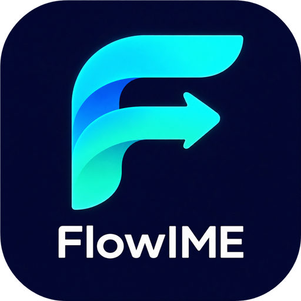

<p align="center">
  
</p>

<p align="center">
  <strong>少切一次输入法，多一点心流。</strong><br>
  聊天中文，终端英文，让输入跟上思路。
</p>

<p align="center">
  FlowIME · 为 Windows 上的 VS Code 用户自动切换中英文输入模式。
</p>

<p align="center">
  <a href="https://marketplace.visualstudio.com/items?itemName=FlowIME.flowime"></a>
  
  <a href="LICENSE"></a>
</p>

<p align="center">
  <a href="https://marketplace.visualstudio.com/items?itemName=FlowIME.flowime"><strong>从 VS Code 市场安装</strong></a>
  &nbsp;·&nbsp;
  <a href="docs/USAGE.md">配置指南</a>
  &nbsp;·&nbsp;
  <a href="https://github.com/haochen12/FlowIME/issues">反馈问题</a>
</p>

<p align="center">
  <strong>简体中文</strong> / <a href="README.en.md">English</a>
</p>

---

## 从中文对话，到终端命令

用中文和 AI 讨论方案，转到终端运行命令，再回到对话继续思考。FlowIME 跟随输入焦点切换中英文，减少来回操作输入法的打断。

| 你正在做什么 | FlowIME 默认行为 |
| --- | --- |
| 在聊天框描述需求 | 请求中文模式 |
| 在集成终端输入命令 | 请求英文模式 |
| 在代码编辑区继续开发 | 保持当前输入法 |
| 在 Markdown 预览等查找框内搜索 | 保持当前输入法 |

- **用熟悉的输入法**：沿用 Windows 已配置的默认输入法，无需额外安装英语键盘。
- **尊重你的选择**：可识别的手动中英文切换会记入当前会话；也可为输入框指定中文、英文或保持不变。
- **少一点来回跳动**：焦点防抖过滤短暂经过的输入框，稳定停留后再切换。
- **随时接管**：点击状态栏即可暂停；内置诊断，方便排查未识别的输入框。密码框和只读控件保持不变。

## 安装与使用

需要 **Windows x64、VS Code 1.96+ 或 Insiders**，以及已配置的中文输入法。

在扩展市场搜索 **FlowIME: Auto Input Switcher**，确认发布者为 **FlowIME** 后安装，或执行：

```powershell
code --install-extension FlowIME.flowime
```

安装即启用。先在聊天框输入一句中文，再到终端输入一条命令，体验随焦点切换。

命令、设置说明、状态栏和操作提示跟随 VS Code 显示语言：中文显示中文，其他语言默认英文。更改显示语言并按 VS Code 提示重启后生效；输入法切换规则不受界面语言影响。

## 常用设置

| 设置 | 默认值 | 用途 |
| --- | --- | --- |
| `autoInput.enabled` | `true` | 启用自动切换 |
| `autoInput.rememberPreferences` | `true` | 记住当前会话的输入框偏好 |
| `autoInput.otherInputs` | `chinese` | 设为 `preserve`，让搜索框等普通输入区域保持不变 |
| `autoInput.pollInterval` | `100` | 焦点检查间隔，50–1000 ms |

偏好不跨助手会话保存。切换效果依赖控件与输入法支持，状态栏显示的是请求目标，不代表已确认实际输入状态；未识别的聊天框可能需要适配。

## 文档与反馈

[使用、旧版迁移与故障排查](docs/USAGE.md) · [兼容性记录](docs/COMPATIBILITY.md) · [维护与发布](docs/MAINTAINING.md) · [更新日志](CHANGELOG.md) · [反馈问题](https://github.com/haochen12/FlowIME/issues/new/choose)

**只关注输入焦点。** 不读取代码或聊天正文，不监听按键，不联网，不上传遥测。当前仅支持 Windows 桌面版 VS Code，不提供系统全局切换。

开发者：**haochen12** · [MIT License](LICENSE) · 独立项目，与 AI 助手厂商无隶属关系。
